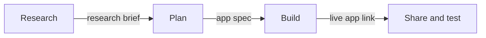

# Founder AI Toolkit

Free and low-cost AI tools for founders. Use them to research your startup idea and build a working prototype. No coding needed: you describe what you want in plain English.

Good options we found, not endorsements or a complete list. Prices and limits last checked November 2026; confirm on each tool's site.

---

## The starter kit

Start with the Free column: every tool in it runs in a web browser with a free account. Pay only when a free limit slows you down. Prices are in US dollars.

| Step | Free | Paid, when you need more |
|---|---|---|
| Research competitors and customers | [Gemini](https://gemini.google.com) Deep Research, [ChatGPT](https://chatgpt.com) | ChatGPT Plus or Google AI Pro (about $20/mo): more deep research reports |
| Check facts | [Perplexity](https://www.perplexity.ai), [Statistics Canada](https://www.statcan.gc.ca) | Perplexity Pro (about $20/mo): more Pro searches |
| Summarize your notes and sources | [Gemini Notebook](https://notebook.google.com) | - |
| Plan your Lean Canvas and app spec | [Claude](https://claude.ai), ChatGPT | Claude Pro ($20/mo): higher limits and Research mode |
| Build your MVP | [Google AI Studio](https://aistudio.google.com) (Build mode), [Lovable](https://lovable.dev), [Bolt](https://bolt.new) | [OpenRouter](https://openrouter.ai/) credit with [Dyad](https://www.dyad.sh/) (about $10, pay as you go), or Lovable Pro or Bolt Pro ($25/mo) |
| Make a landing page or pitch deck | [Gamma](https://gamma.app) (400 credits, once) | Gamma Plus: 1,500 credits/mo and no Gamma badge |
| Collect feedback | [Tally](https://tally.so), [Google Forms](https://forms.google.com) | - |

**Pick a budget:**

- **$0:** the Free column is enough to research an idea and build a working demo.
- **About $10:** OpenRouter credit, paid once and spent as you use it. Useful when builder credits run out.
- **About $20 to $25/mo:** one subscription for the step that slows you down most, usually building. Pay for one month, then cancel if you don't need more.

---

## How the tools work together

Use each tool for one job, and pass a short markdown file from one to the next. The [prompt pack](prompts.md) has a prompt for each step.

Feedback from testing goes back into your plan, and the cycle repeats.

1. **Plan in chat, build in a builder.** Chat assistants have generous free limits. App builders give you only a few prompts a day. Make your decisions in chat, then give the builder one clear spec.
2. **Research with one tool, check with another.** The AI that wrote a report is a poor judge of it.
3. **Ground the AI in your own material.** Add your reports and interview notes to Gemini Notebook, so answers come from your sources.
4. **Keep your work portable.** Keep your files in one [Google Drive](https://drive.google.com) folder, and prefer builders that export code to GitHub (Google AI Studio and Lovable do). Then you can switch tools without starting over.

**Three levels of building.** None of them need you to write code. Start at level 1, and move up only when it holds you back.

1. **In your browser (start here):** Google AI Studio, Lovable or Bolt. Nothing to install, and enough for a working prototype. When one runs out of free credits, paste the same spec into the next.
2. **A desktop app:** [Google Antigravity](https://antigravity.google/) (free), or Dyad with OpenRouter credit (about $10). You install one app and keep describing what you want in plain English, with more room than a browser builder. Google AI Studio can export a prototype straight to Antigravity.
3. **The terminal:** if you're comfortable typing commands, agents such as [OpenCode](https://opencode.ai/), [Pi](https://pi.dev/) and [Hermes Agent](https://hermes-agent.nousresearch.com/docs/) run on the same cheap OpenRouter models.

The [build guide](build.md) explains each level.

---

## Other tools to explore

The starter kit is one good path, not the only one. These tools do the same jobs, and each has a free plan or free trial. Try one if it suits you better.

- **Research:** [Mistral Vibe](https://chat.mistral.ai) (a European AI assistant with web search), [Semrush](https://www.semrush.com) (which search keywords bring visitors to competitors' websites).
- **Check facts:** [Consensus](https://consensus.app) (answers from published research papers), [Open Government Portal](https://open.canada.ca) (free Canadian government datasets).
- **Summarize your sources:** [ChatPDF](https://www.chatpdf.com) (ask questions about one PDF, such as an industry report).
- **Plan:** [Miro](https://miro.com) (a whiteboard with a Lean Canvas template), [Notion](https://www.notion.com) (keep your research, canvas and spec in one place), [FigJam](https://www.figma.com/figjam/) (sketch your app's screens).
- **Build in your browser:** [Replit](https://replit.com) (apps that need a real backend), [Base44](https://base44.com) (simple apps with logins), [v0](https://v0.app) (web apps and sites from a prompt), [Figma Make](https://www.figma.com/make/) (clickable prototypes from a prompt or a design), [Bubble](https://bubble.io) (an app you then edit visually; going live is paid).
- **Build on your desktop:** [Cursor](https://cursor.com) (an AI code editor), [Kiro](https://kiro.dev) (an AI coding app that works from a spec).
- **Build in the terminal:** [Aider](https://aider.chat) (an open-source coding agent that works with an OpenRouter key), [GitHub Copilot CLI](https://docs.github.com/en/copilot/how-tos/use-copilot-agents/use-copilot-cli) (GitHub's coding agent, on its free plan).
- **Pitch deck or landing page:** [Canva](https://www.canva.com) (decks from templates), [Pitch](https://pitch.com) (made for startup decks), [Carrd](https://carrd.com) (simple one-page websites).
- **Collect feedback:** [Fillout](https://www.fillout.com) (forms and surveys), [Calendly](https://calendly.com) (let people book an interview time).

---

## Before you start

1. **Use a personal Google account.** Some tools require you to be 18 or older.
2. **Turn off chat training** in each AI tool before you type in your idea. The [research guide](research.md#keep-your-idea-private) shows where.
3. **Check every number and link** the AI gives you before you rely on it.

---

## Guides

- **[Prompt pack](prompts.md):** a copy-paste prompt for each step, from research brief to working app. Each one gives you a markdown file for the next step.
- **[Research your idea](research.md):** which AI tool to use for each research task, Canadian data sources, how to check facts, and how to keep your idea private.
- **[Build your MVP](build.md):** app builders compared (including Replit), planning with a spec, making free credits last, desktop tools, and the $10 OpenRouter option.
- **[Conestoga student resources](conestoga-students.md):** free tools, library databases, student offers and startup programs for students with a @conestogac.on.ca email.
